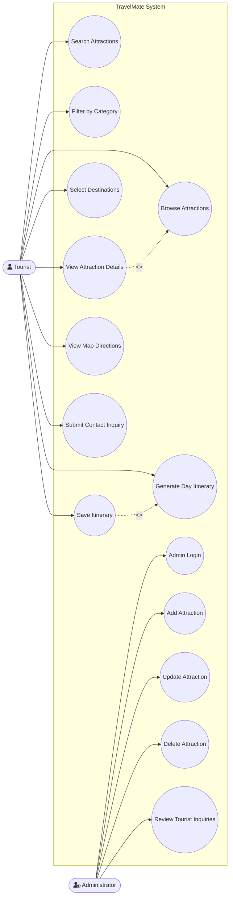
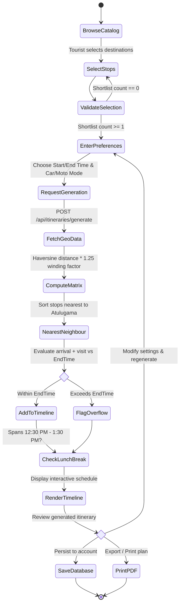
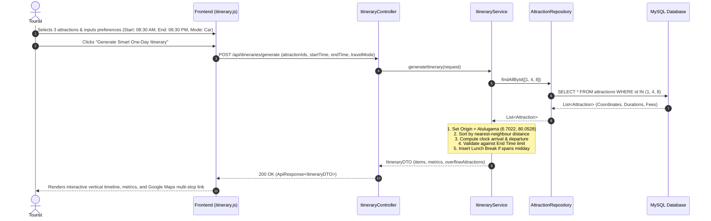
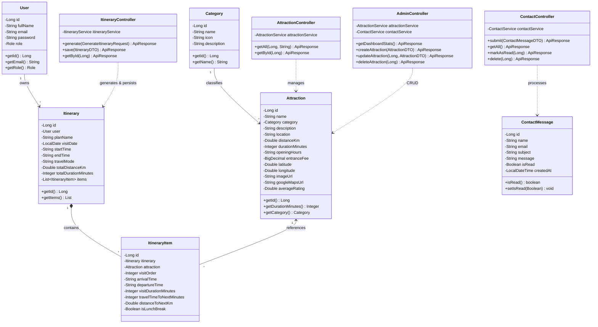
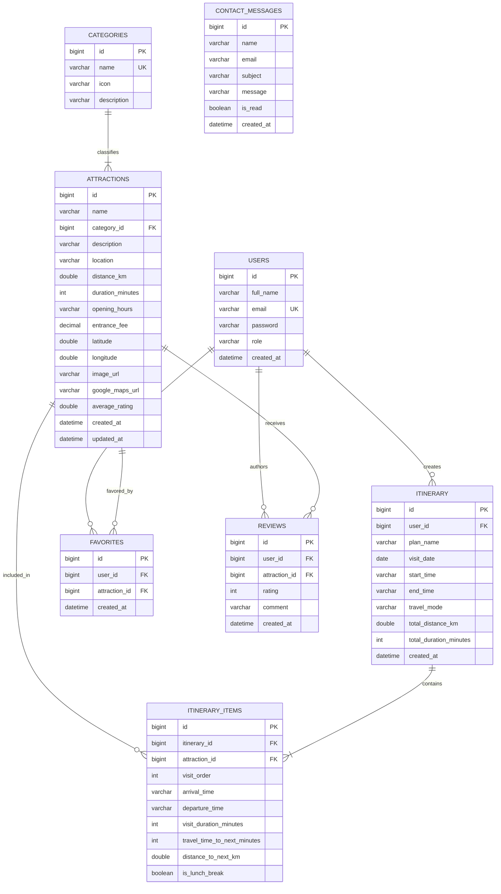

# StarUML System Design Specifications — TravelMate

**Project:** TravelMate – Smart Tourist Day-Visit Planner  
**Course Module:** ITE2953 – Software Project  
**Institution:** University of Moratuwa, Sri Lanka  
**Student:** Rukshana Roshan (Registration No: E2410132)  

---

## StarUML Authoring Guide

> [!NOTE]
> To create these diagrams in **StarUML** (v5.x / v6.x):
> 1. Launch StarUML and create a new project: `File` &rarr; `New From Template` &rarr; `UML Minimal`.
> 2. Right-click on the Model Explorer root and select `Add Diagram` &rarr; `<Diagram Type>` (Use Case, Activity, Sequence, Class, or ERD).
> 3. Use the toolbox elements detailed below to draw actors, classes, entities, lifelines, and messages.
> 4. Below each diagram specification, we provide standard **Mermaid diagram code** that renders natively in GitHub, markdown readers, and StarUML's markdown preview plugin.

---

## 1. Use Case Diagram

### StarUML Modeling Elements
- **System Boundary:** `TravelMate Smart Tourist Day-Visit Planner`
- **Primary Actors:**
  - `Tourist` (End-user planning day trips)
  - `Administrator` (Authorized site manager)
- **Use Cases:**
  - **Tourist:**
    - `Browse Attractions`
    - `Search Attractions`
    - `Filter Attractions by Category`
    - `View Attraction Details`
    - `Select Destinations` (Shortlist)
    - `Generate Day Itinerary` (Deterministic nearest-neighbour algorithm)
    - `Save Itinerary` (Requires Tourist Authentication, extends Generate Itinerary)
    - `View Google Maps Route / Directions`
    - `Submit Contact Inquiry`
  - **Administrator:**
    - `Authenticate / Admin Login`
    - `Manage Attractions` (`<<include>>` Add Attraction, Update Attraction, Delete Attraction)
    - `Manage Categories`
    - `Review Tourist Inquiries`

---

## 2. Activity Diagram: One-Day Itinerary Planning Process

### StarUML Activity Nodes
1. **Initial Node:** Tourist opens Planner interface.
2. **Action 1:** Browse & Shortlist Attractions from Explore catalog.
3. **Decision 1:** Shortlist has at least 1 destination? If No &rarr; prompt user to select destinations.
4. **Action 2:** Input trip preferences (Start Time, Finish Time, Travel Mode: Car vs Motorcycle).
5. **Action 3:** Click "Generate One-Day Itinerary" button.
6. **Action 4:** Engine queries coordinates and visiting durations from repository.
7. **Action 5:** Calculate road distances via Haversine $\times$ 1.25 road-winding multiplier.
8. **Action 6:** Apply Nearest-Neighbour sequence starting from Atulugama (`6.7022, 80.0528`).
9. **Decision 2:** Cumulative arrival + visit fits within available finish time?
   - **Yes:** Schedule destination node on active timeline.
   - **No:** Append to overflow advisory list.
10. **Action 7:** Check if journey spans 12:30 PM - 1:30 PM; insert lunch break slot.
11. **Action 8:** Render clock-synchronized vertical timeline, summary metrics, and Google Maps route.
12. **Decision 3:** User wants to modify or save?
   - **Modify:** Reorder stops or change time preferences &rarr; re-generate.
   - **Save:** Authenticate and persist to MySQL database.
   - **Print:** Export PDF / Print schedule.
13. **Final Activity Node:** Day plan finalized.

---

## 3. Sequence Diagram: Day Itinerary Generation

### Participating Lifelines
1. `Tourist`: User interacting with the browser.
2. `Frontend (itinerary.js)`: Browser client UI.
3. `ItineraryController`: Spring Boot REST Controller endpoint (`POST /api/itineraries/generate`).
4. `ItineraryService`: Service layer implementing the deterministic nearest-neighbour algorithm.
5. `AttractionRepository`: Spring Data JPA data access layer.
6. `MySQL Database`: Persistent relational database.

---

## 4. Class Diagram

### Implemented Architectural Classes

---

## 5. ER / EER Diagram (Entity Relationship Diagram)

### MySQL Relational Schema
Represents the normalized database schema created in `src/main/resources/sql/schema_and_seed_data.sql`.

